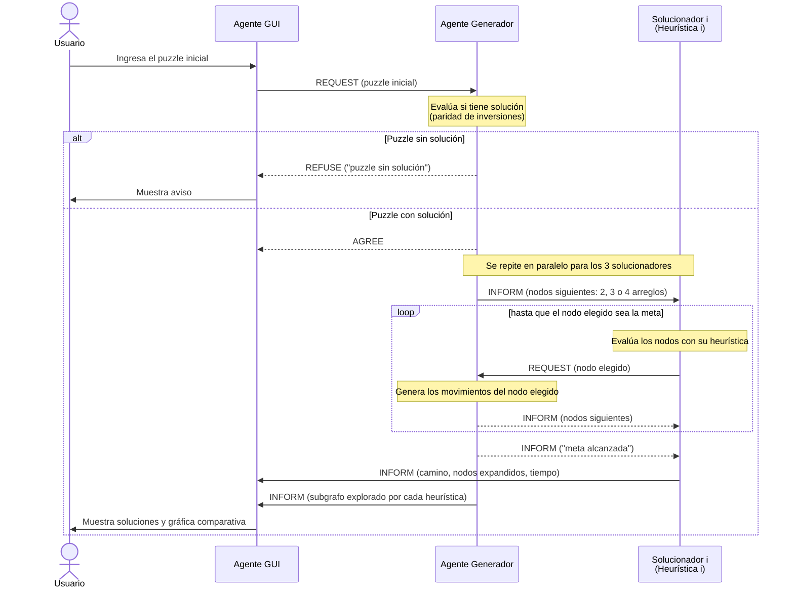

# SMA8Puzzle

Sistema Multiagente en **JADE** que resuelve el **8-Puzzle**. Los agentes se comunican con mensajes **FIPA-ACL** y exploran el espacio de estados con **Greedy Best-First Search**, usando tres heurísticas distintas. Al final se comparan gráficamente.

> **Estado actual:** fase de diseño (demo). Todavía no hay código; este documento fija los acuerdos para que cada integrante pueda implementar su parte sin depender de los demás.

## Equipo
| Parte | Responsable |
|---|---|
| Agente Generador del espacio de soluciones, Agente GUI y diseño | Wilberth Mancinas |
| Agentes Solucionadores (uno por heurística) | Compañeros del equipo |

## Agentes
| Agente | Responsabilidad |
|---|---|
| **GUI** | Recibe el puzzle del usuario, se lo entrega al generador y muestra las soluciones y la gráfica comparativa. No valida el puzzle. |
| **Generador** | Evalúa si el puzzle tiene solución (paridad de inversiones) y genera los nodos siguientes de cada estado que le pidan. Registra lo explorado por cada heurística. |
| **Solucionador 1, 2, 3** | Cada uno aplica Greedy Best-First con su propia heurística: elige qué nodo expandir y reporta su resultado a la GUI. |

## Decisiones de diseño preliminares

| | **Decisión 1: Representación de estados** | **Decisión 2: Generación bajo demanda** |
|---|---|---|
| **Qué decidimos** | Cada estado es un arreglo de 9 enteros leído por filas, con `0` como espacio vacío. Ejemplo: `[1,2,3,4,0,6,7,5,8]` | El generador no envía el grafo completo: manda los nodos siguientes, el solucionador elige uno con su heurística y el generador genera los siguientes de ese nodo, y así sucesivamente |
| **Cómo funciona** | Estado → `int[9]` · Nodos siguientes → 2, 3 o 4 arreglos · Meta → `[1,2,3,4,5,6,7,8,0]` | Generador → `INFORM` (nodos siguientes) · Solucionador → `REQUEST` (nodo elegido) · Puzzle sin solución → `REFUSE` |
| **Por qué** | Viaja directo en el mensaje con `setContentObject(...)` (los `int[]` ya son serializables) sin crear clases compartidas | Solo se genera del 0.1 % al 2 % de los 181,440 estados alcanzables; además, el generador registra lo que exploró cada heurística |
| **Evita dependencias porque…** | Todos usan el mismo formato desde el inicio, sin esperar a que alguien programe una clase `Estado` | Cada quien programa y prueba su agente por separado, simulando a los demás con el Dummy Agent de JADE |
| **Alternativa descartada** | Objeto Java propio: obliga a que todos compartan exactamente la misma clase | Enviar el grafo completo: mensaje enorme, estados que nunca se usan y esperar a que termine la generación |

### Contrato de mensajes
| Momento | De → A | Performativa | Contenido |
|---|---|---|---|
| Entregar puzzle | GUI → Generador | `REQUEST` | estado inicial (`int[9]`) |
| Puzzle sin solución | Generador → GUI | `REFUSE` | `"puzzle sin solución"` |
| Puzzle aceptado | Generador → GUI | `AGREE` | — |
| Nodos siguientes | Generador → Solucionador | `INFORM` | 2, 3 o 4 estados (`int[9]` cada uno) |
| Nodo elegido | Solucionador → Generador | `REQUEST` | estado elegido (`int[9]`) |
| Fin de la búsqueda | Generador → Solucionador | `INFORM` | `"meta alcanzada"` |
| Puzzle a animar | Generador → GUI de cada solucionador (`gui1`, `gui2`, `gui3`) | `INFORM` | estado inicial (`int[9]`) |
| Resultado | Solucionador → `gui` **y** su `guiN` | `INFORM` | `heuristica=...;camino=...;expandidos=...;tiempoMs=...` |
| Exploración | Generador → GUI | `INFORM` | subgrafo explorado por cada heurística |

> **Importante para los solucionadores:** el nodo elegido debe ser el mejor de **toda** su lista abierta (todos los nodos recibidos y aún no expandidos), no solo de los 2–4 que acaban de llegar. Si no, el algoritmo se convierte en *hill climbing* y puede atorarse sin llegar a la meta.

## Diagrama de secuencia



## Datos del espacio de estados
| Dato | Valor |
|---|---|
| Estados alcanzables desde la meta | 181,440 (la mitad de 9! = 362,880) |
| Movimientos del hueco | 2 en esquina · 3 en orilla · 4 en el centro |
| Solución óptima más larga | 31 movimientos |
| Distancia óptima promedio | ≈ 22 movimientos |
| ¿Tiene solución? | Sí, si el número de inversiones (sin contar el 0) es **par** |

## Cómo abrirlo
1. IntelliJ IDEA → *File → Open* → carpeta del repo.
2. JDK 21 (*File → Project Structure → SDK*).
3. JADE 4.6.0 ya viene incluido en `lib/jade.jar` como librería `jade`.
4. Ejecutar la configuración **JADE Plataforma** (`jade.Boot -gui`).

> Si sale `No ICP active`, ya hay otra plataforma JADE usando el puerto 1099: ciérrala primero.

## GUI de cada solucionador (esta rama)

Cada integrante corre, junto a su solucionador, su propia GUI (`GUISolucionador.AgenteGUISolucionador`). Esa GUI:
1. Muestra el puzzle en cuanto se presiona **Resolver** en la GUI principal (se lo manda el generador).
2. Cuando llega el resultado de su solucionador, **anima la solución paso a paso** (0.25 s por movimiento).
3. Al terminar, muestra e imprime: `heurística: N movimientos · E expandidos · T ms`.

La GUI principal (`gui`) oculta el tablero, espera a los 3 solucionadores y luego **compara** movimientos, nodos expandidos y tiempo.

### Qué copiar a tu proyecto
- La carpeta `src/GUISolucionador/` completa (incluye `styles/`).
- Las librerías de JavaFX de `lib/` (`javafx-base`, `javafx-graphics`, `javafx-controls`): vienen las de **Windows (`-win`)** y **Linux (`-linux`)**. Agrégalas como librería en *File → Project Structure → Libraries*.

### Nombre de la GUI
Usa el mismo número que tu solucionador: `solucionador1` → `gui1`, `solucionador2` → `gui2`, `solucionador3` → `gui3`.

### Cambio en tu solucionador
Al reportar el resultado, agrega tu GUI como segundo destinatario:
```java
ACLMessage msg = new ACLMessage(ACLMessage.INFORM);
msg.addReceiver(new AID("gui", AID.ISLOCALNAME));   // comparación (GUI principal)
msg.addReceiver(new AID("gui3", AID.ISLOCALNAME));  // tu GUI: anima la solución
msg.setContent("heuristica=euclidiana;camino=...;expandidos=...;tiempoMs=...");
```
- `camino`: los estados desde el primer movimiento hasta la meta, separados con `>` (ej. `[1, 2, 3, 4, 5, 6, 7, 0, 8]>[1, 2, 3, 4, 5, 6, 7, 8, 0]`).
- `tiempoMs`: el tiempo que midió **tu** solucionador; es el que se compara.

### Cómo ejecutarlo
- **Probar sola tu GUI**: configuración **JADE GUI Solucionador** (`-gui -agents "gui3:GUISolucionador.AgenteGUISolucionador"`). Aparece el tablero con "Esperando puzzle…".
- **En red** (ver *Ejecutar en varias computadoras* en la rama `AgenteGUI`): agrega tu GUI a la línea `-agents` de tu contenedor:
```
-container -host IP_PRINCIPAL -port 1099 -local-host TU_IP -local-port 1100 -agents "solucionador3:AgenteEuclidiano.AgenteEuclidiano;gui3:GUISolucionador.AgenteGUISolucionador"
```
