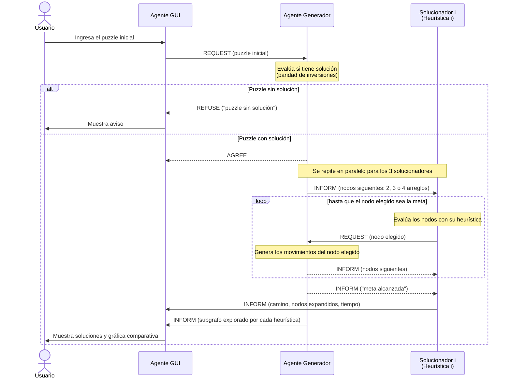

# SMA8Puzzle

Sistema Multiagente en **JADE** que resuelve el **8-Puzzle**. Los agentes se comunican con mensajes **FIPA-ACL** y exploran el espacio de estados con **Greedy Best-First Search**, usando tres heurísticas distintas. Al final se comparan gráficamente.

> **Estado actual:** fase de diseño (demo). Todavía no hay código; este documento fija los acuerdos para que cada integrante pueda implementar su parte sin depender de los demás.

## Equipo
| Parte | Responsable |
|---|---|
| Agente Generador del espacio de soluciones, Agente GUI y diseño | Wilberth Mancinas |
| Agentes Solucionadores (uno por heurística) | Compañeros del equipo |

## Agentes
| Agente | Responsabilidad |
|---|---|
| **GUI** | Recibe el puzzle del usuario, se lo entrega al generador y muestra las soluciones y la gráfica comparativa. No valida el puzzle. |
| **Generador** | Evalúa si el puzzle tiene solución (paridad de inversiones) y genera los nodos siguientes de cada estado que le pidan. Registra lo explorado por cada heurística. |
| **Solucionador 1, 2, 3** | Cada uno aplica Greedy Best-First con su propia heurística: elige qué nodo expandir y reporta su resultado a la GUI. |

## Decisiones de diseño preliminares

| | **Decisión 1: Representación de estados** | **Decisión 2: Generación bajo demanda** |
|---|---|---|
| **Qué decidimos** | Cada estado es un arreglo de 9 enteros leído por filas, con `0` como espacio vacío. Ejemplo: `[1,2,3,4,0,6,7,5,8]` | El generador no envía el grafo completo: manda los nodos siguientes, el solucionador elige uno con su heurística y el generador genera los siguientes de ese nodo, y así sucesivamente |
| **Cómo funciona** | Estado → `int[9]` · Nodos siguientes → 2, 3 o 4 arreglos · Meta → `[1,2,3,4,5,6,7,8,0]` | Generador → `INFORM` (nodos siguientes) · Solucionador → `REQUEST` (nodo elegido) · Puzzle sin solución → `REFUSE` |
| **Por qué** | Viaja directo en el mensaje con `setContentObject(...)` (los `int[]` ya son serializables) sin crear clases compartidas | Solo se genera del 0.1 % al 2 % de los 181,440 estados alcanzables; además, el generador registra lo que exploró cada heurística |
| **Evita dependencias porque…** | Todos usan el mismo formato desde el inicio, sin esperar a que alguien programe una clase `Estado` | Cada quien programa y prueba su agente por separado, simulando a los demás con el Dummy Agent de JADE |
| **Alternativa descartada** | Objeto Java propio: obliga a que todos compartan exactamente la misma clase | Enviar el grafo completo: mensaje enorme, estados que nunca se usan y esperar a que termine la generación |

### Contrato de mensajes
| Momento | De → A | Performativa | Contenido |
|---|---|---|---|
| Entregar puzzle | GUI → Generador | `REQUEST` | estado inicial (`int[9]`) |
| Puzzle sin solución | Generador → GUI | `REFUSE` | `"puzzle sin solución"` |
| Puzzle aceptado | Generador → GUI | `AGREE` | — |
| Nodos siguientes | Generador → Solucionador | `INFORM` | 2, 3 o 4 estados (`int[9]` cada uno) |
| Nodo elegido | Solucionador → Generador | `REQUEST` | estado elegido (`int[9]`) |
| Fin de la búsqueda | Generador → Solucionador | `INFORM` | `"meta alcanzada"` |
| Puzzle a animar | Generador → GUI de cada solucionador (`gui1`, `gui2`, `gui3`) | `INFORM` | estado inicial (`int[9]`) |
| Resultado | Solucionador → `gui` **y** su `guiN` | `INFORM` | `heuristica=...;camino=...;expandidos=...;tiempoMs=...` (tiempo de procesador, con decimales) |
| Exploración | Generador → GUI | `INFORM` | subgrafo explorado por cada heurística |

> **Importante para los solucionadores:** el nodo elegido debe ser el mejor de **toda** su lista abierta (todos los nodos recibidos y aún no expandidos), no solo de los 2–4 que acaban de llegar. Si no, el algoritmo se convierte en *hill climbing* y puede atorarse sin llegar a la meta.

## Diagrama de secuencia



## Datos del espacio de estados
| Dato | Valor |
|---|---|
| Estados alcanzables desde la meta | 181,440 (la mitad de 9! = 362,880) |
| Movimientos del hueco | 2 en esquina · 3 en orilla · 4 en el centro |
| Solución óptima más larga | 31 movimientos |
| Distancia óptima promedio | ≈ 22 movimientos |
| ¿Tiene solución? | Sí, si el número de inversiones (sin contar el 0) es **par** |

## Cómo abrirlo
1. IntelliJ IDEA → *File → Open* → carpeta del repo.
2. JDK 21 (*File → Project Structure → SDK*).
3. JADE 4.6.0 ya viene incluido en `lib/jade.jar` como librería `jade`.
4. Ejecutar la configuración **JADE Plataforma** (`jade.Boot -gui`).

> Si sale `No ICP active`, ya hay otra plataforma JADE usando el puerto 1099: ciérrala primero.

## Ejecutar en varias computadoras (JADE en red)

Es **una sola plataforma JADE repartida en varias computadoras**:
- **Principal**: la computadora con la GUI y el generador (abre la ventana de JADE).
- **Contenedores**: cada integrante se **une** a esa plataforma con su solucionador. Los agentes se encuentran por su nombre, igual que en una sola computadora.

### Requisitos de cada solucionador
1. **Nombre exacto**: `solucionador1`, `solucionador2` o `solucionador3` (el generador les manda los mensajes con esos nombres; no puede haber dos iguales).
2. **Seguir el contrato de mensajes**:
   - Recibe `INFORM` del `generador` con `int[][]` (vecinos): `(int[][]) msg.getContentObject()`.
   - El primer mensaje (sin `in-reply-to`) es un puzzle nuevo.
   - Pide vecinos con `REQUEST` al `generador` y el nodo elegido como `int[]` (`setContentObject`).
   - Reporta a la `gui` **y** a su `guiN` con `INFORM`: `heuristica=...;camino=...;expandidos=...;tiempoMs=...`
   - `tiempoMs` es tiempo de procesador: no cuenta la espera de red ni los `println` (ver rama `AgenteGUIparaSolucionadores`).
3. **El mismo `jade.jar` (4.6.0)** que el proyecto.

### Paso 1: misma red
- Todos en la misma red Wi-Fi (**UABC funcionó**; si falla, usar el hotspot de un celular).
- Cada quien obtiene su IP: Linux `ip -4 addr` · Windows `ipconfig` → **Dirección IPv4**.
- La IP puede cambiar de un día a otro: revisarla antes de cada prueba.

### Paso 2: computadora principal
*Main class* `jade.Boot`, *Program arguments*:
```
-gui -nomtp -local-host IP_PRINCIPAL -local-port 1099 -agents "gui:GUI.AgenteGUI;generador:AgenteGenerador.AgenteGenerador"
```
- `-local-host` es **obligatorio en Ubuntu**: sin él, JADE anuncia `127.0.1.1` y nadie se puede unir.
- `-nomtp` apaga el puerto 7778, que no se usa.
- Si el firewall `ufw` está activo: `sudo ufw allow from IP_COMPAÑERO to any port 1099 proto tcp`.

### Paso 3: computadora de cada solucionador
*Main class* `jade.Boot`, *Program arguments*:
```
-container -host IP_PRINCIPAL -port 1099 -local-host IP_DEL_COMPAÑERO -local-port 1100 -agents "solucionadorN:Paquete.ClaseDelAgente"
```
Ejemplo (solucionador 3):
```
-container -host 10.21.26.144 -port 1099 -local-host 10.21.40.37 -local-port 1100 -agents "solucionador3:AgenteEuclidiano.AgenteEuclidiano"
```
- `-container`: se une a la plataforma principal en lugar de crear otra.
- **Sin `-gui`**: la ventana de JADE solo la abre la principal.
- Si dos solucionadores corren en la **misma** computadora, cada uno usa otro `-local-port` (1100, 1101...).

### Paso 4: firewall de Windows (en cada solucionador)
La principal se conecta al **puerto 1100** del compañero para entregarle mensajes. En **PowerShell como administrador** (clic derecho → *Ejecutar como administrador*):
```powershell
New-NetFirewallRule -DisplayName "JADE 1100" -Direction Inbound -Protocol TCP -LocalPort 1100 -RemoteAddress IP_PRINCIPAL -Action Allow -Profile Any
```
Al terminar la demo:
```powershell
Remove-NetFirewallRule -DisplayName "JADE 1100"
```

### Paso 5: orden de arranque
1. La **principal** arranca y espera a que aparezca la ventana de JADE.
2. Cada **solucionador** arranca su contenedor. En su consola: `Agent container Container-N@SU_IP is ready.`
3. En la ventana de JADE aparece un **Container-N** por compañero, con su solucionador adentro.
4. Presionar **Resolver**: el tablero se oculta y aparece "Esperando solucionadores" con la cuenta (1 de 3, 2 de 3...). Al llegar los 3 resultados se muestra la comparación de movimientos, nodos expandidos y tiempo de procesador.

### Errores frecuentes
| Error | Causa | Solución |
|---|---|---|
| La principal corre sin `-local-host` | IntelliJ no mostraba la configuración nueva | *File → Reload All from Disk* o reabrir el proyecto |
| `Can't get a proxy to the Platform Manager ... Permission denied` | El contenedor arrancó antes de que la principal estuviera lista | Arrancar primero la principal y esperar la ventana de JADE |
| `Acceso denegado` en `New-NetFirewallRule` | PowerShell sin permisos de administrador | *Ejecutar como administrador* |
| Container-N aparece, pero el solucionador no recibe nada | El firewall de Windows bloquea el puerto 1100 | Paso 4 |
| Tailscale no conecta en la universidad | El firewall Fortinet de UABC lo bloquea | Usar la red UABC directamente o el hotspot |
| En el hotspot, la laptop se regresa sola a UABC | El hotspot no tiene internet (datos apagados) | Elegir el hotspot manualmente |
